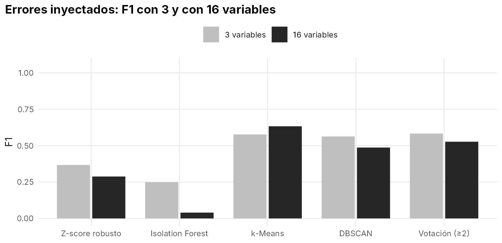
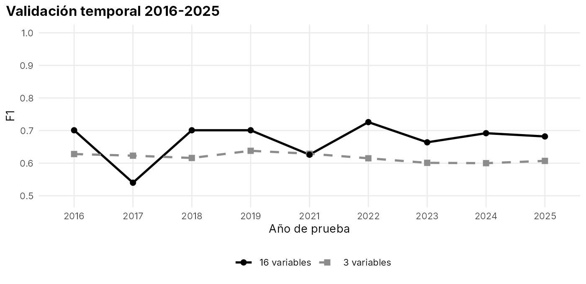

## Cómo ejecutarlo

1. Descargar o clonar el repositorio y abrir **`ena-anomalias-2015-2025.Rproj`** en RStudio (así el directorio de trabajo queda en la raíz).
2. Abrir `scripts/R/ejecutar_todo.R` y pulsar **Source**. También se pueden correr `00` a `05` uno por uno; cada script carga lo que necesita si no está en memoria.
3. Las figuras se guardan en `figuras/R/` y las tablas en `resultados/R/`.

La primera vez se instalan `data.table`, `ggplot2`, `isotree`, `dbscan`, `cluster` y `readxl`. R usa hasta unos 5 GB de RAM (conviene una computadora con 8 GB o más). Las etapas 3 y 4 tardan unos 5 minutos y la validación unos 25.

R parte de la base depositada (`ena_2014_2025_productor.csv.gz`), que ya está integrada y limpia. La lectura del SPSS de 14,7 GB y la limpieza (etapas 1 y 2) están en el notebook de Python.

| Etapa | Python | R |
|---|---|---|
| Variables | `crear_variables`, `z_robusto` | mismas funciones en `funciones.R` (`data.table`) |
| Isolation Forest | `sklearn.ensemble.IsolationForest` | `isotree::isolation.forest(ndim = 1)` |
| k-Means | `sklearn.cluster.KMeans` | `stats::kmeans` |
| DBSCAN | `sklearn.cluster.DBSCAN` | `dbscan::kNNdist` + núcleos + `dbscan::kNN` |
| Silueta | `sklearn.metrics.silhouette_score` | `cluster::silhouette` |
| AUC | `roc_auc_score` | `auc_rangos` (Mann-Whitney) |

## Resultados de R frente a Python

Con la misma base, R marca **10 463 registros como anómalos (0,84 %)**, frente a 8 802 (0,70 %) en Python. Las diferencias se deben a la aleatoriedad de cada método y a detalles de implementación (k-Means de `stats` frente a `scikit-learn`, árboles de `isotree`). El z-score robusto coincide casi por completo y la tendencia por año se repite (1,14 % en 2015 y 0,45 % en 2025).

| Método (16 variables) | Python (%) | R (%) | Acuerdo (%) | Kappa | Anómalos en ambos |
| --- | ---: | ---: | ---: | ---: | ---: |
| Z-score robusto | 2,90 | 2,97 | 99,86 | 0,976 | 35 825 |
| Isolation Forest | 1,00 | 1,00 | 99,29 | 0,641 | 8 068 |
| k-Means | 1,00 | 1,00 | 99,13 | 0,560 | 7 058 |
| DBSCAN | 0,61 | 0,64 | 99,60 | 0,681 | 5 344 |
| Votación (≥2) | 0,70 | 0,84 | 99,51 | 0,679 | 6 565 |

: Marcas del modelo de 16 variables: Python (columnas `flag_*` de la base) frente a R. {#tbl-r-python}

| Modelo | Método | F1 Python | F1 R | AUC Python | AUC R |
| --- | --- | ---: | ---: | ---: | ---: |
| 3 variables | k-Means | 0,609 | 0,577 | 0,799 | 0,795 |
| 3 variables | Votación (≥2) | 0,617 | 0,583 | 0,764 | 0,794 |
| 16 variables | k-Means | 0,662 | 0,633 | 0,981 | 0,985 |
| 16 variables | Votación (≥2) | 0,530 | 0,527 | 0,949 | 0,968 |

: Errores inyectados: F1 y AUC en Python y en R. {#tbl-r-inyeccion}

| Modelo | F1 medio Python | F1 medio R | AUC medio Python | AUC medio R |
| --- | ---: | ---: | ---: | ---: |
| 3 variables | 0,635 | 0,617 | 0,767 | 0,794 |
| 16 variables | 0,646 | 0,670 | 0,944 | 0,974 |

: Validación temporal 2016–2025 (promedio de los 9 años de prueba). {#tbl-r-temporal}

Las conclusiones del informe se mantienen en R: con 16 variables k-Means es el mejor detector individual, Isolation Forest pierde casi toda su capacidad y la votación ordena mejor a los sospechosos (AUC mayor) con un F1 parecido al del modelo de 3 variables.

::: {layout-ncol=2}



:::


## Scripts

::: {.panel-tabset}

### 00 · Configuración

```{.r include="scripts/R/00_configuracion.R" filename="scripts/R/00_configuracion.R"}
```

### Funciones

```{.r include="scripts/R/funciones.R" filename="scripts/R/funciones.R"}
```

### 01 · Datos

```{.r include="scripts/R/01_cargar_datos.R" filename="scripts/R/01_cargar_datos.R"}
```

### 02 · Variables

```{.r include="scripts/R/02_variables.R" filename="scripts/R/02_variables.R"}
```

### 03 · Modelos

```{.r include="scripts/R/03_modelos.R" filename="scripts/R/03_modelos.R"}
```

### 04 · Resultados

```{.r include="scripts/R/04_resultados.R" filename="scripts/R/04_resultados.R"}
```

### 05 · Validación

```{.r include="scripts/R/05_validacion.R" filename="scripts/R/05_validacion.R"}
```

### Ejecutar todo

```{.r include="scripts/R/ejecutar_todo.R" filename="scripts/R/ejecutar_todo.R"}
```

### Exportar base

```{.r include="scripts/R/exportar_base.R" filename="scripts/R/exportar_base.R"}
```

:::
