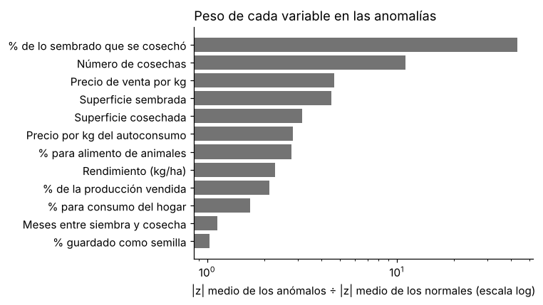
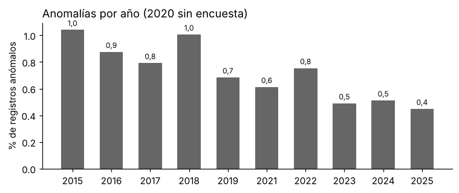
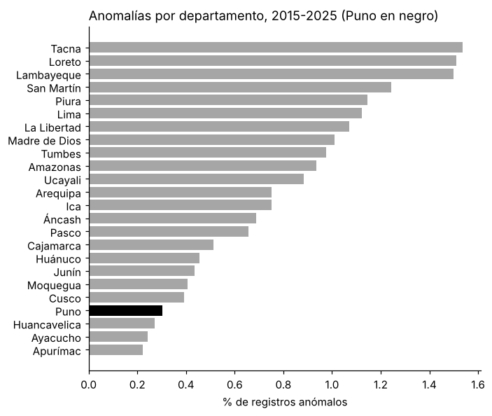
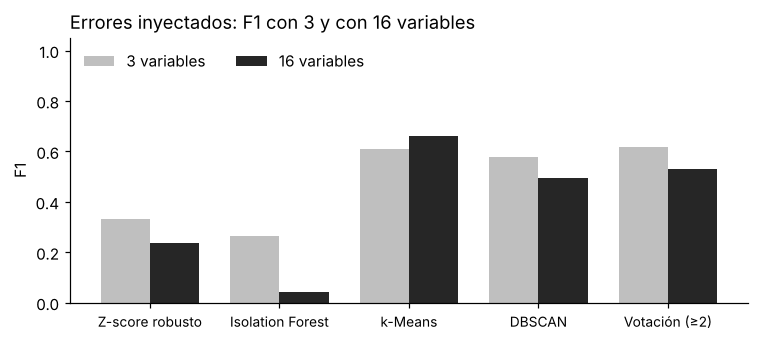
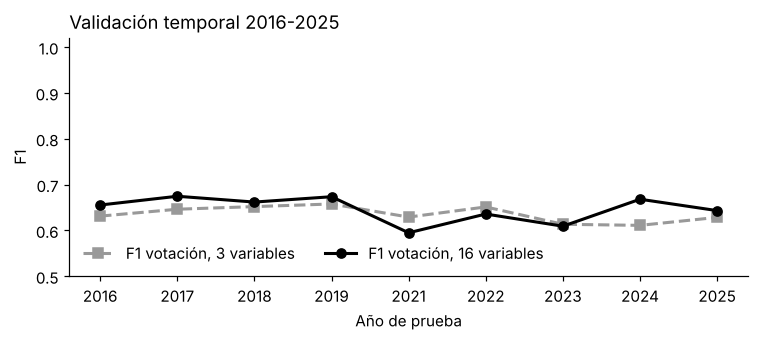

::: {.callout-note appearance="minimal"}
Curso: Ciencia de Datos I (VIII semestre) · Docente: Fred Torres Cruz · Escuela Profesional de Ingeniería Estadística e Informática, UNA Puno.
:::

# Problema

La Encuesta Nacional Agropecuaria (ENA) del INEI registra cada año, para cada productor, los cultivos que cosechó: superficie, producción y lo que vendió con su precio [@inei_ena]. Los datos se recogen en campo y se digitan a mano, así que pueden traer errores: un cero de más, kilos anotados como toneladas o una superficie en metros cuadrados en lugar de hectáreas.

**Objetivo.** Detectar de forma automática, sin etiquetas, los registros que se apartan mucho de lo normal para su mismo cultivo, año y región, y validar la detección con todo el rango de años disponible. El análisis es nacional; Puno se presenta como caso. Todo el proceso está en funciones de Python (`ena_anomalias.py`) y se ejecuta en el notebook `Deteccion_Anomalias_ENA_2015_2025.ipynb`; las etapas 3 a 5 también están en R para RStudio ([Código en R](codigo-r.qmd)).

# Datos

| Fuente | Contenido | Tamaño |
|---|---|---|
| ENA 2014–2024 (SPSS) | Todos los capítulos apilados; se leen 43 columnas | 14,7 GB · 3 843 598 filas · 1 704 variables |
| ENA 2025 (21 zip) | Un CSV por capítulo; cultivos en `03_CAP200AB.csv` (módulo 1895) | 158 747 filas de cultivos |
| Unidad de análisis | Un cultivo cosechado por un productor en una parcela y un año (capítulo 200) | 1 250 818 registros útiles |

: Fuentes de datos. {#tbl-fuentes}

No existe la ENA 2020 (no se realizó por la pandemia) y en 2014 el INEI no publicó superficie, cantidad ni valor de venta. Por eso 2014 entra en la integración y la limpieza, pero el modelo trabaja con 2015–2025 (10 años).

# Proceso por etapas

| Etapa | Qué hace | Funciones |
|---|---|---|
| 1. Carga e integración | Lee solo las columnas necesarias del SPSS y del CSV 2025 y las une | `leer_sav`, `agregar_factor_parcela`, `leer_2025`, `integrar` |
| 2. Limpieza | Filtra, reconstruye cifras, convierte unidades y quita duplicados | `limpiar` |
| 3. Variables | 16 variables (12 numéricas + 4 categóricas) comparadas con su cultivo, año y región | `crear_variables`, `z_robusto`, `desvio_grupo` |
| 4. Modelos | Cuatro detectores y votación | `detectar_z`, `detectar_dbscan`, `detectar_kmeans`, `detectar_iforest`, `detectar_todo` |
| 5. Validación | Silueta, reglas lógicas, errores inyectados y validación año por año | `validar_silueta`, `validar_reglas`, `validar_inyeccion`, `validar_temporal` |

: Etapas del trabajo. {#tbl-etapas}

## Integración: la superficie en hectáreas

El productor declara la superficie en la unidad local de su parcela (m², topos, yugadas…). El INEI publica la conversión a hectáreas salvo en 2015 y 2018. Usada tal cual, el 12 % de los registros parece anómalo solo por la unidad. Para esos dos años reconstruimos las hectáreas con un factor por parcela (hectáreas de la parcela ÷ superficie en su unidad). En los años con dato oficial, el método coincide en el 100 % de 783 865 registros comparados.

## Limpieza

| Paso | Registros que quedan |
|---|---:|
| Filas con nombre de cultivo (todas las secciones) | 1 658 156 |
| Cultivos cosechados (sección 200A, con N° de cultivo) | 1 493 391 |
| Solo encuestas completas (RESFIN = 1) | 1 492 147 |
| Sin 2014 (sin cantidades ni superficies) | 1 413 650 |
| Con superficie, cantidad y equivalencia en kg | 1 267 692 |
| Sin códigos de relleno (145 eliminados) | 1 267 547 |
| Superficie y producción mayores que cero | 1 267 547 |
| Sin duplicados | 1 267 083 |
| Cultivos con 30 registros o más en el año | **1 250 818** |

: Embudo de limpieza. {#tbl-embudo}

El SPSS declara UTF-8 pero trae bytes inválidos (se lee en latin1); las cifras vienen partidas en entero y decimales como texto (`'069'` = 0,069); la producción se pasa a kilogramos con la equivalencia de cada unidad (saco, arroba, quintal…).

## Variables: de 3 a 16

| # | Variable | Cálculo | Transformación |
|---|---|---|---|
| 1 | Rendimiento\* | kg ÷ ha cosechadas | z robusto del log |
| 2 | Precio de venta por kg\* | valor ÷ kg vendidos | z robusto del log |
| 3 | Superficie cosechada\* | ha | z robusto del log |
| 4 | Superficie sembrada | ha | z robusto del log |
| 5 | % de lo sembrado que se cosechó | ha cosechadas ÷ ha sembradas | desvío del grupo |
| 6 | % de la producción vendida | vendida ÷ producida | desvío del grupo |
| 7 | % para consumo del hogar | consumida ÷ producida | desvío del grupo |
| 8 | % para alimento de animales | a animales ÷ producida | desvío del grupo |
| 9 | % guardado como semilla | semilla ÷ producida | desvío del grupo |
| 10 | Número de cosechas | P205 | desvío del log |
| 11 | Precio por kg del autoconsumo | valor consumo ÷ kg | z robusto del log |
| 12 | Meses entre siembra y cosecha | cosecha − siembra | desvío del grupo |
| 13–16 | Tipo de cultivo, conducción, fuente de agua, región natural | — | categóricas (0/1) |

: Variables del modelo ampliado (\* = modelo base de 3). {#tbl-variables}

Las continuas se pasan a logaritmo y a un z robusto, $z = (x - \text{mediana}) / (1{,}4826 \cdot \text{MAD})$, dentro del mismo cultivo, año y región natural. En proporciones y conteos la MAD suele ser 0, por eso se usa el desvío a la mediana del grupo dividido entre la desviación estándar global. Un dato faltante queda en 0 (neutral). La correlación más alta entre dos variables numéricas es 0,73.

## Modelos

Se usan los cuatro métodos del artículo de referencia [@herreros2024], combinados por votación:

- **Z-score robusto:** anómalo si una variable continua supera $|z| = 3{,}5$ [@iglewicz1993].
- **DBSCAN** [@ester1996]: anómalo si queda como ruido. Se ajusta con una muestra de 40 000 (eps = percentil 98 de la curva k-distancia, 20 vecinos) y cada registro se clasifica por su distancia al punto núcleo más cercano.
- **k-Means:** anómalo si está en el 1 % más lejano de su centroide; k = 3 (mejor silueta, 0,11).
- **Isolation Forest** [@liu2008]: 200 árboles, 1 % de contaminación.
- **Votación:** anomalía final si la marcan dos o más métodos.

# Resultados

De 1 250 818 registros, la votación marca **8 802 como anómalos (0,70 %)**. Los modelos de 3 y 16 variables comparten 4 003 anomalías.

{#fig-importancia width=85%}

El % de lo sembrado que se cosechó y el número de cosechas son las variables que más separan a los anómalos; siguen el precio de venta y la superficie sembrada.

{#fig-anio width=85%}

La tasa baja de 1,04 % en 2015 a 0,45 % en 2025, lo que sugiere que la captura de datos mejoró.

{#fig-dep width=75%}

Tacna, Loreto, Lambayeque, San Martín y Piura tienen más anomalías (costa y selva, hortalizas de varias cosechas y cultivos comerciales). Los de sierra (Apurímac, Ayacucho, Huancavelica, Puno) tienen las tasas más bajas. Por cultivo destacan el maíz chala (4,3 %), el arroz cáscara, la yuca y el orégano.

## Caso Puno

Puno aporta 79 148 registros y 240 anomalías (0,30 %), la cuarta tasa más baja del país. Aparecen cultivos andinos: papa nativa (41), avena forrajera (23) y quinua (19), además de la coca (23).

| Año | Cultivo | Ha cosech. | Producción (kg) | Rend. (kg/ha) | Precio (S/ kg) | Cosechas | Votos |
|---|---|---:|---:|---:|---:|---:|---:|
| 2022 | Rocoto | 0,010 | 30 | 3 000 | – | 1 | 4 |
| 2022 | Rocoto | 0,001 | 7 | 7 000 | – | 1 | 4 |
| 2022 | Pasto Dactylis | 0,160 | 8 000 | 50 000 | 0,50 | 1 | 4 |
| 2022 | Pasto Brizanta | 0,200 | 1 000 | 5 000 | 0,50 | 1 | 4 |
| 2015 | Espinaca | 0,000 | 1 | 5 000 | – | 1 | 3 |
| 2015 | Rocoto | 0,020 | 135 | 6 750 | – | 3 | 3 |

: Registros anómalos de Puno con más votos. {#tbl-puno}

Una anomalía no prueba un error: es un registro que conviene revisar con alguien que conozca el cultivo.

# Disponibilidad de datos {#sec-datos}

::: {.cajadatos}

**Fuente primaria.** Microdatos oficiales de la Encuesta Nacional Agropecuaria del INEI: archivo SPSS 2014–2024 y archivos CSV de 2025 (módulo 1895), descargables en el portal de microdatos del INEI [@inei_ena]. Los microdatos crudos no se redistribuyen en el repositorio por su tamaño (14,7 GB).

**Base procesada y código.** La base consolidada `ena_2014_2025_productor.csv.gz` (1 329 315 registros, 33 variables, sin identificadores de productor), su diccionario de variables, las tablas de resultados y el código en Python y en R están depositados en Zenodo con identificador persistente:

**DOI:** [](https://doi.org/)  ·  **Código fuente:** [GitHub]()

Licencias: datos CC BY 4.0 y código MIT. Detalle de columnas en [Datos y código](datos.qmd).
:::

Cómo citar los datos: @ena_anomalias_zenodo.

# Validación: 3 contra 16 variables

No hay una lista oficial de registros erróneos. Se valida de cuatro formas, de la más débil a la más fuerte.

## Silueta

| Partición (16 variables) | Silueta |
|---|---:|
| k-Means (k = 3) | 0,110 |
| Normal vs anómalo: Z-score robusto | 0,352 |
| Normal vs anómalo: Isolation Forest | 0,307 |
| Normal vs anómalo: k-Means | 0,638 |
| Normal vs anómalo: DBSCAN | 0,614 |
| Normal vs anómalo: Votación (≥ 2) | 0,591 |

: Coeficiente de silueta (muestra de 20 000 registros). {#tbl-silueta}

Con 16 variables los grupos de k-Means casi no se separan (0,11; con 3 era 0,26), efecto de la dimensionalidad. La silueta solo mide separación, no que las anomalías sean errores.

## Reglas lógicas

R1 (vendió más de lo que cosechó) tiene 0 casos y R2 (cosechó más de lo que sembró) 3, señal de que el INEI ya depura esas inconsistencias. R3 (valor de venta ≠ cantidad × precio) tiene 206 casos:

| Método | Detecta (3 var.) | Lift (3) | Detecta (16 var.) | Lift (16) |
|---|---:|---:|---:|---:|
| Z-score robusto | 14,1 % | 5,6 | 18,0 % | 6,2 |
| Isolation Forest | 12,1 % | 12,2 | 3,4 % | 3,4 |
| k-Means | 11,7 % | 11,7 | 6,8 % | 6,8 |
| DBSCAN | 12,1 % | 12,4 | 9,7 % | 15,9 |
| Votación (≥ 2) | 13,1 % | 10,1 | 10,7 % | 15,2 |

: Detección de la regla R3. {#tbl-reglas}

## Errores inyectados

Al 1 % de los registros normales se le inyectan cinco errores de digitación: A) producción × 10, B) kg ↔ t, C) valor × 10, D) sembrada × 10 y E) cosechas × 10.

| Método | F1 (3) | AUC (3) | Precisión (16) | Recall (16) | F1 (16) | AUC (16) |
|---|---:|---:|---:|---:|---:|---:|
| Z-score robusto | 0,333 | 0,797 | 0,152 | 0,543 | 0,238 | 0,829 |
| Isolation Forest | 0,266 | 0,791 | 0,043 | 0,042 | 0,042 | 0,752 |
| k-Means | 0,609 | 0,799 | 0,670 | 0,654 | **0,662** | **0,981** |
| DBSCAN | 0,579 | 0,775 | 0,858 | 0,348 | 0,495 | 0,931 |
| Votación (≥ 2) | 0,617 | 0,764 | 0,944 | 0,368 | 0,530 | 0,949 |

: Validación con errores inyectados. {#tbl-inyeccion}

{#fig-inyeccion width=85%}

El modelo de 3 variables no ve los errores D y E (0 %); con 16, k-Means detecta casi todos (100 % y 99 %). Isolation Forest no aprovecha las variables extra (F1 0,04) y arrastra a la votación (F1 0,53 frente a 0,62), aunque su AUC sube de 0,76 a 0,95.

## Validación temporal 2016–2025

Se entrena con los años anteriores y se prueba en el siguiente, con los errores inyectados en el año de prueba.

| Año de prueba | Entrenado con | F1 (3) | AUC (3) | F1 (16) | AUC (16) |
|---|---|---:|---:|---:|---:|
| 2016 | 2015 | 0,631 | 0,761 | 0,655 | 0,951 |
| 2017 | 2015–2016 | 0,646 | 0,777 | 0,674 | 0,957 |
| 2018 | 2015–2017 | 0,652 | 0,776 | 0,662 | 0,954 |
| 2019 | 2015–2018 | 0,658 | 0,777 | 0,673 | 0,953 |
| 2021 | 2015–2019 | 0,629 | 0,764 | 0,595 | 0,955 |
| 2022 | 2015–2021 | 0,651 | 0,777 | 0,636 | 0,949 |
| 2023 | 2015–2022 | 0,613 | 0,758 | 0,609 | 0,899 |
| 2024 | 2015–2023 | 0,611 | 0,753 | 0,668 | 0,936 |
| 2025 | 2015–2024 | 0,628 | 0,757 | 0,643 | 0,942 |

: Validación temporal de la votación. {#tbl-temporal}

{#fig-temporal width=85%}

El F1 medio es casi igual (0,64 con 3 variables y 0,65 con 16), pero el AUC con 16 es mucho mayor (≈ 0,94 frente a ≈ 0,77). El resultado es estable año a año.

# Comparación con el artículo de referencia

| Aspecto | Artículo | Este trabajo |
|---|---|---|
| Datos | 65 000 órdenes de compra, 2 empresas, 1 año | 1,25 millones de registros, 25 departamentos, 10 años |
| Variables | Monto y atributos de la orden | 16 (12 numéricas + 4 categóricas) vs. base de 3 |
| Contexto | Monto global | z robusto por cultivo, año y región |
| Validación | Silueta + revisión de expertos | Silueta + reglas + errores inyectados + validación temporal |

: Comparación con @herreros2024. {#tbl-comparacion}

# Conclusiones

- La limpieza fue decisiva: sin convertir la superficie a hectáreas, el 12 % de los registros parecía anómalo. La reconstrucción de 2015 y 2018 coincide al 100 % con el INEI en los demás años.
- Con 16 variables la votación marca el 0,70 % de los registros; pesan más el % de lo sembrado que se cosechó y el número de cosechas.
- Más variables no siempre es mejor: k-Means mejora (F1 0,66, AUC 0,98) e Isolation Forest empeora. Se recomienda usar las 16 variables con k-Means o con la votación y revisar primero los registros con más votos.
- La silueta sola no basta; los errores inyectados y la validación temporal sí miden precisión y recall.

**Limitaciones.** No hay ENA 2020, 2014 no trae cantidades y 2021 no trae fecha de siembra. Los errores inyectados son simulados. No se usaron factores de expansión, porque el interés está en el registro individual.

# Referencias {.unnumbered}

::: {#refs}
:::
