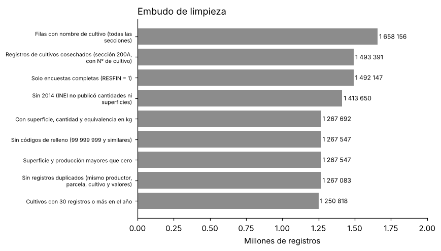
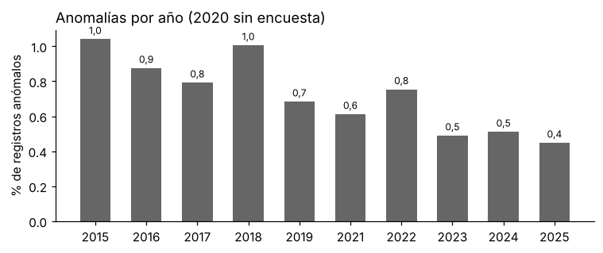
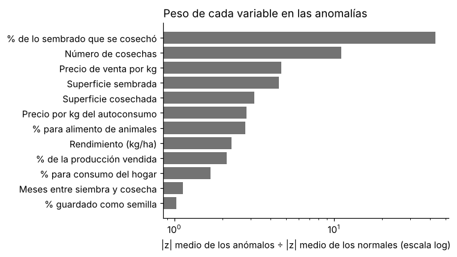
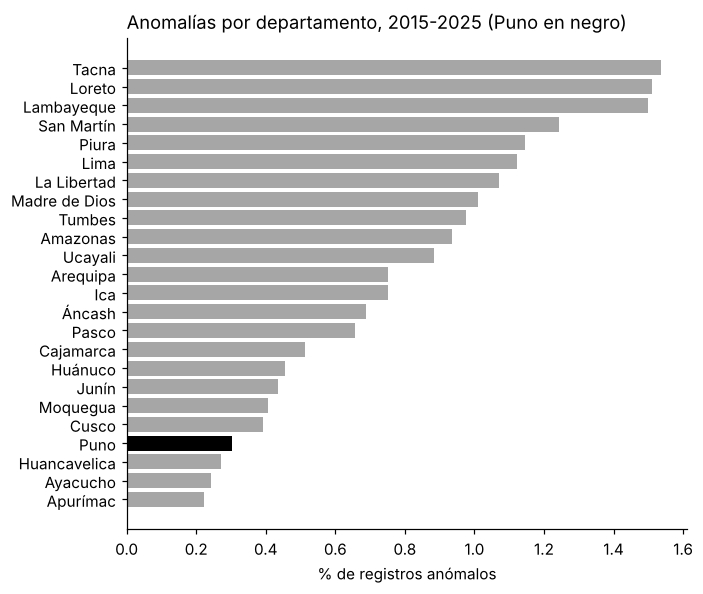
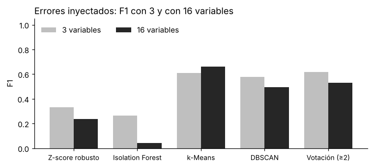
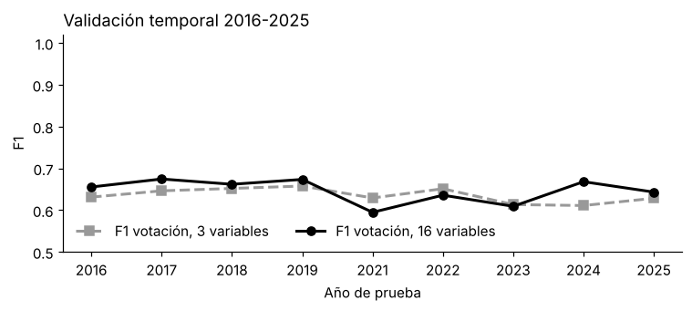

## El problema

- La ENA registra, por productor, superficie, producción y ventas de cada cultivo.
- Se digita a mano: un cero de más, kg como toneladas, m² como hectáreas.
- **Objetivo:** detectar sin etiquetas los registros que se apartan de su mismo cultivo, año y región, y validar la detección con 2015–2025.

## Datos

| Fuente | Tamaño |
|---|---|
| ENA 2014–2024 (SPSS) | 14,7 GB · 3 843 598 filas · 1 704 variables |
| ENA 2025 (21 zip, módulo 1895) | 158 747 filas de cultivos |
| **Registros útiles (2015–2025)** | **1 250 818** |

::: {.callout-note}
No hay ENA 2020 y 2014 no trae superficie, cantidad ni valor de venta.
:::

## Hallazgo clave: la superficie

- El productor declara la superficie en su unidad local (m², topos, yugadas).
- 2015 y 2018 no traen la conversión oficial → **12 % de falsos anómalos**.
- Reconstruimos con un factor por parcela: **coincide al 100 %** con el INEI en 783 865 registros.

## Limpieza

{width=80%}

## De 3 a 16 variables

:::: {.columns}
::: {.column width="50%"}
**Modelo base (3)**

- Rendimiento
- Precio por kg
- Superficie cosechada
:::
::: {.column width="50%"}
**Se agregan (13)**

- Superficie sembrada, % cosechado
- Destino: venta, hogar, animales, semilla
- Nº de cosechas, precio autoconsumo, meses de ciclo
- Tipo, conducción, agua, región
:::
::::

z robusto por cultivo × año × región: z = (x − mediana) / (1,4826 · MAD)

## Cuatro detectores + votación

| Método | Marca como anómalo si… |
|---|---|
| Z-score robusto | \|z\| > 3,5 |
| DBSCAN | queda como ruido |
| k-Means (k = 3) | 1 % más lejano de su centroide |
| Isolation Forest | se aísla con pocos cortes (1 %) |
| **Votación** | **2 o más métodos lo marcan** |

## Resultados

:::: {.columns}
::: {.column width="40%"}
- **8 802 anomalías (0,70 %)**
- De 1,04 % (2015) a 0,45 % (2025)
- Más en costa y selva: Tacna, Loreto, Lambayeque
- Puno: 240 de 79 148 (0,30 %)
:::
::: {.column width="60%"}

:::
::::

## ¿Qué variables pesan?

{width=85%}

## Por departamento

{height=560}

## Validación con errores inyectados

{width=75%}

- 3 variables: ciego a errores de superficie sembrada y cosechas (0 %).
- 16 variables: **k-Means F1 0,66 · AUC 0,98**.

## Validación temporal 2016–2025

{width=75%}

F1 similar (0,64 vs 0,65); AUC mucho mayor con 16 variables (≈ 0,94 vs 0,77).

## Conclusiones

- La limpieza de unidades fue la etapa decisiva.
- Con 16 variables, usar **k-Means o la votación** y revisar primero los registros con más votos.
- La silueta sola no valida; los errores inyectados y la validación temporal sí.
- Una anomalía es un registro a revisar, no un error probado.

## Disponibilidad de datos

- **Fuente primaria:** microdatos ENA del INEI (2014–2025).
- **Base procesada + código:** Zenodo, DOI [](https://doi.org/)

- **Repositorio y sitio:** [GitHub]() · [Informe web]()
- Licencias: datos CC BY 4.0 · código MIT

## Gracias {.center}

Informe completo: []()
